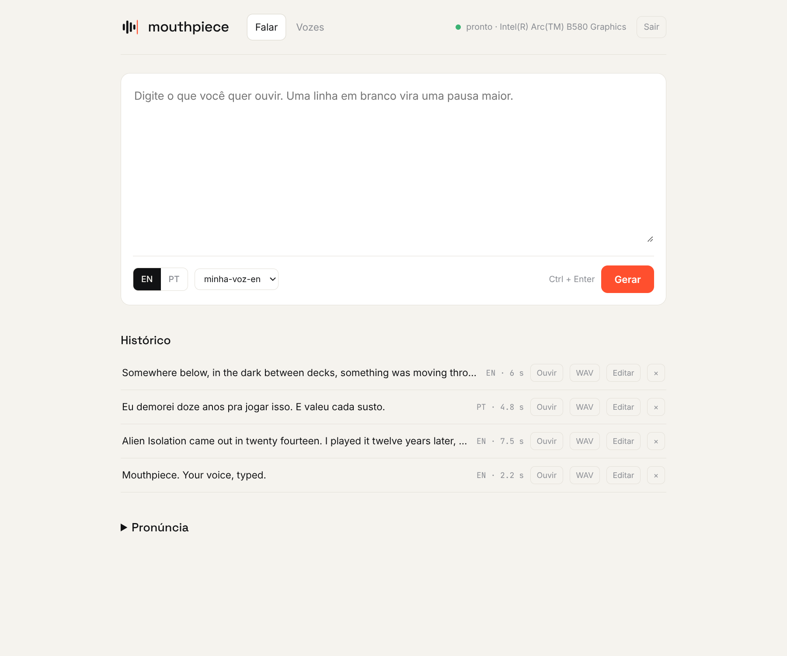
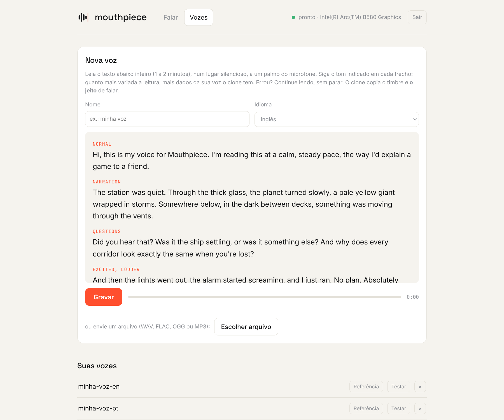
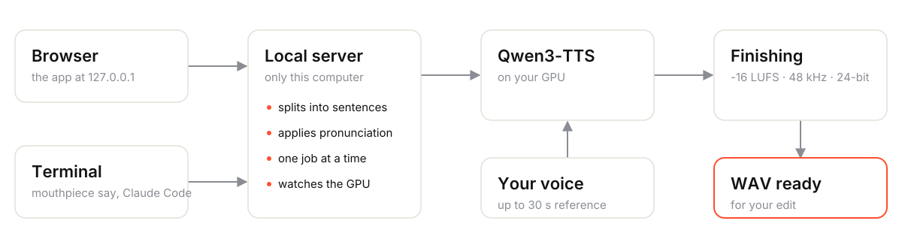

<p align="center">
  
</p>

<p align="center">
  <b>your voice, typed.</b><br>
  Type some text and hear it in your own voice. Everything runs on your computer.
</p>

<p align="center">
  
  
  
  
</p>

<p align="center"><b>English</b> · <a href="README.pt-BR.md">Português</a></p>

<p align="center">
  
</p>

---

**Mouthpiece** clones your voice from a 1-2 minute reading and speaks any text with it, in **English
or Portuguese**. You hear a preview and download a WAV that's ready to edit. Made for people who
record narration, video essays, podcasts or tutorials and are tired of re-recording line by line.

- **Your voice, not a stock one.** Cloned from a recording you make inside the app.
- **Edit-ready.** Mono WAV, 48 kHz, 24-bit, **-16 LUFS**, peaks under -1.5 dBFS.
- **Private.** The model runs on your own GPU. No text or audio leaves your computer.
- **In the browser or in the terminal.** A `mouthpiece` command for scripts, and a skill so Claude
  Code can write and voice narration on its own while you edit videos.

> The app's interface is in Portuguese for now; it speaks both English and Portuguese.

## Install

### Windows

1. Download **`Mouthpiece-Setup.exe`** from [Releases](../../releases).
2. Run it. It doesn't need administrator rights, and it:
   - downloads Python, the right PyTorch for your GPU and the voice model (**a few GB**), showing the
     progress in a window;
   - adds Start menu (and, if you want, desktop) shortcuts and the `mouthpiece` command.
3. Open **Mouthpiece** from the Start menu.

> Windows 10/11 64-bit, ~10 GB free. Recommended: an **Intel Arc** or **NVIDIA** GPU with 8 GB or
> more. Without a supported GPU it runs on the CPU, just much slower.

### Linux

Download **`mouthpiece-<version>-linux.tar.gz`** from [Releases](../../releases), then:

```bash
tar xzf mouthpiece-*-linux.tar.gz && cd mouthpiece-*-linux
./install.sh          # detects your GPU and downloads everything (a few GB)
```

It installs to `~/.local/lib/mouthpiece`, adds the `mouthpiece` command and an app-menu entry, and
fetches [uv](https://docs.astral.sh/uv/) if you don't have it. For Intel Arc you need
`intel-compute-runtime` and `level-zero-loader`; for NVIDIA, the proprietary driver.
`./uninstall.sh` removes it (your voices stay).

From source instead: `git clone` this repository, then `./setup.sh` and `./start.sh`.

## How to use it

### 1. Create your voice



In the **Vozes** (Voices) tab, click **Gravar** (Record) and read the on-screen script out loud. It
takes 1-2 minutes, somewhere quiet. The script has parts in different tones (normal, narration,
questions, excited, quiet), numbers, names and **every sound of the language**, so the clone gets as
much of your voice as possible. You can also upload a recording (WAV, FLAC, OGG or MP3).

> The clone copies your timbre **and your delivery**. Record in the tone you want to hear later.

### 2. Generate

In the **Falar** (Speak) tab, pick **EN** or **PT**, type and click **Gerar** (Generate), or press
`Ctrl+Enter`. The preview plays by itself. **Baixar WAV** downloads it, named after the text.

- A blank line becomes a longer pause.
- Long text is split into sentences for you (up to 6,000 characters, about 15 minutes of speech).
- **Pronunciation:** "written → spoken" rules for names it gets wrong, like
  `Alien: Isolation` → `Alien Isolation`.

### 3. Quit

**Sair** (Quit) closes Mouthpiece and frees the GPU memory. Left idle, it closes itself after
20 minutes.

## Terminal

```bash
mouthpiece say "Twelve years late." -o narration.wav
mouthpiece say -f script.txt -o narration.wav --lang pt
echo "text" | mouthpiece say - -o narration.wav
mouthpiece say "..." -o scene1.wav --json     # {"path", "duration", "frames_30", "frames_60", ...}
mouthpiece voice add recording.wav --name "my voice" --lang en
mouthpiece voices | open | status | stop
mouthpiece pronuncia add "Alien: Isolation" "Alien Isolation"
```

If the app isn't open, the command starts the server and waits for the model. `--json` returns the
duration in frames, so the line drops straight onto a timeline.

## Claude Code

The skill in [`claude-skill/narration`](claude-skill/narration/SKILL.md) teaches Claude to write the
line, generate it with `mouthpiece` and fit it into a [Remotion](https://www.remotion.dev/) timeline
by its length in frames. To install it:

```bash
ln -sfn "$PWD/claude-skill/narration" ~/.claude/skills/narration
```

Then just ask, for example: *"write and voice a narration for this scene about the motion tracker"*.

## How it works

<picture>
  <source media="(prefers-color-scheme: dark)" srcset="docs/how-it-works-dark.svg">
  
</picture>

- **Model:** [Qwen3-TTS](https://github.com/QwenLM/Qwen3-TTS) 1.7B (voice cloning), pinned to an exact
  revision so your voice never changes without notice.
- **GPU:** Intel Arc through PyTorch XPU, NVIDIA through CUDA, or the CPU. Detected at install time
  and at startup.
- **Finishing:** loudness measured to EBU R128 and a peak limiter, in pure Python (no ffmpeg).
- **One generation at a time**, with a watchdog that notices a stuck GPU instead of waiting forever.

## Where your files live

| | Windows | Linux |
|---|---|---|
| Voices, generated audio, rules | `%APPDATA%\Mouthpiece` | `~/.local/share/mouthpiece` |
| Model (~4 GB) | `%USERPROFILE%\.cache\huggingface` | `~/.cache/huggingface` |

Uninstalling removes the app but **keeps your voices and the model**.

## Privacy and responsible use

- The server only accepts connections from your own computer and rejects requests coming from other
  websites: no page open in your browser can make it speak in your voice.
- **Only clone your own voice, or one you have permission to use.** Imitating someone else's voice
  without consent can be illegal, and is dishonest at best.

## Troubleshooting

| Symptom | What to do |
|---|---|
| "placa travada" (GPU stuck) | A game is competing for the GPU. Close it and reopen Mouthpiece. |
| Too slow | Without a supported GPU it runs on the CPU. An Intel Arc or NVIDIA GPU is about 10x faster. |
| A name comes out wrong | Add a **Pronúncia** (pronunciation) rule, spelled the way it's said. |
| It doesn't sound like you | Record again: the whole script, somewhere quiet, in the tone you want. |
| Install failed (Windows) | Check `setup.log` in the app folder and run `setup.ps1` again. |

## Development

| Path | What |
|---|---|
| `server.py`, `audio.py`, `cli.py` | Server, audio finishing and the `mouthpiece` command |
| `static/` | The app (dependency-free HTML, CSS and JS) and the reading scripts (`scripts.json`) |
| `brand/` | Brand kit ([`BRAND.md`](brand/BRAND.md)); `python3 brand/build.py` builds logos and icons |
| `install/` | Windows installer (Inno Setup) and Linux install scripts |
| `tests/` | The post-install smoke test the release workflow runs on Windows and Linux |
| `claude-skill/` | The Claude Code skill |

Releases are built by GitHub Actions: pushing a `v*` tag builds the Windows installer and the Linux
package, installs each one on a clean machine, creates a voice and speaks a line, and only then
publishes the release.

## Credits

- [Qwen3-TTS](https://github.com/QwenLM/Qwen3-TTS) by the Qwen team (Alibaba), Apache 2.0.
- Fonts: [Space Grotesk](https://github.com/floriankarsten/space-grotesk),
  [Inter](https://rsms.me/inter/) and [JetBrains Mono](https://www.jetbrains.com/lp/mono/), OFL.
- Made for the **Dude, We Late** channel: *videos about games. eventually.*
