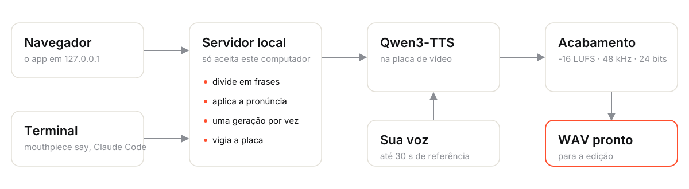

<p align="center">
  
</p>

<p align="center">
  <b>your voice, typed.</b><br>
  Digite um texto e ouça com a sua própria voz. Tudo roda no seu computador.
</p>

<p align="center">
  
  
  
  
</p>

<p align="center">
  
</p>

---

O **Mouthpiece** clona a sua voz a partir de uma leitura de 1 a 2 minutos e fala qualquer texto com
ela, em **inglês ou português**. Você ouve a prévia e baixa um WAV pronto para a edição. Feito para
quem grava narração, vídeo-ensaio, podcast ou tutorial e não quer ficar regravando frase por frase.

- **A sua voz, não uma voz genérica.** Clonagem a partir de uma gravação feita no próprio app.
- **Pronto para editar.** WAV mono, 48 kHz, 24 bits, **-16 LUFS**, picos abaixo de -1,5 dBFS.
- **Privado.** O modelo roda na sua placa de vídeo. Nenhum texto ou áudio sai do computador.
- **Pelo navegador ou pelo terminal.** Um comando `mouthpiece` para scripts, e uma skill para o
  Claude Code gerar narração sozinho enquanto edita vídeos.

## Instalar

### Windows

1. Baixe **`Mouthpiece-Setup.exe`** na página de [Releases](../../releases).
2. Rode o instalador. Ele não pede administrador e:
   - baixa o Python, o PyTorch certo para a sua placa e o modelo de voz (**alguns GB**), mostrando o
     progresso numa janela;
   - cria atalhos no Menu Iniciar (e na Área de Trabalho, se quiser) e o comando `mouthpiece`.
3. Abra o **Mouthpiece** pelo Menu Iniciar.

> Windows 10/11 64 bits, ~10 GB livres. Recomendado: placa **Intel Arc** ou **NVIDIA** com 8 GB ou
> mais. Sem placa compatível ele roda na CPU, só que bem mais devagar.

### Linux

```bash
git clone https://github.com/sidnei-almeida/mouthpiece && cd mouthpiece
./setup.sh                                    # detecta a placa e baixa tudo (alguns GB)
ln -sf "$PWD/cli.py" ~/.local/bin/mouthpiece  # o comando
./start.sh                                    # abre o app
```

Precisa do [uv](https://docs.astral.sh/uv/). Para Intel Arc: `intel-compute-runtime` e
`level-zero-loader`. Para NVIDIA: o driver proprietário.

## Como usar

### 1. Crie a sua voz


Na aba **Vozes**, clique em **Gravar** e leia em voz alta o roteiro da tela. São 1 a 2 minutos, num
lugar silencioso. O roteiro tem trechos com tons diferentes (normal, narração, perguntas, empolgado,
baixinho), números, nomes e **todos os sons do idioma**, para o clone ter o máximo de dados da sua
voz. Também dá para enviar um arquivo pronto (WAV, FLAC, OGG ou MP3).

> O clone copia o timbre **e o jeito** da gravação. Grave no tom em que quer ouvir a voz depois.

### 2. Gere

Na aba **Falar**, escolha **EN** ou **PT**, digite e clique **Gerar** (ou `Ctrl+Enter`). A prévia toca
sozinha. **Baixar WAV** salva o arquivo com um nome tirado do texto.

- Uma linha em branco vira uma pausa maior.
- Textos longos são divididos em frases sozinhos (até 6.000 caracteres, uns 15 minutos de fala).
- **Pronúncia:** regras "escrito → falado" para nomes que saem errados, como
  `Alien: Isolation` → `Alien Isolation`.

### 3. Saia

O botão **Sair** fecha o Mouthpiece e libera a memória da placa de vídeo. Sem uso, ele fecha sozinho
depois de 20 minutos.

## Terminal

```bash
mouthpiece say "Twelve years late." -o narracao.wav
mouthpiece say -f roteiro.txt -o narracao.wav --lang pt
echo "texto" | mouthpiece say - -o narracao.wav
mouthpiece say "..." -o cena1.wav --json     # {"path", "duration", "frames_30", "frames_60", ...}
mouthpiece voices | open | status | stop
mouthpiece pronuncia add "Alien: Isolation" "Alien Isolation"
```

Se o app não estiver aberto, o comando abre o servidor sozinho e espera o modelo carregar. O `--json`
devolve a duração em frames, para encaixar a fala direto numa timeline.

## Claude Code

A skill em [`claude-skill/narration`](claude-skill/narration/SKILL.md) ensina o Claude a escrever a
fala, gerar com `mouthpiece` e encaixá-la no [Remotion](https://www.remotion.dev/) pela duração em
frames. Para instalar:

```bash
ln -sfn "$PWD/claude-skill/narration" ~/.claude/skills/narration
```

Depois é só pedir, por exemplo: *"gera uma narração para essa cena explicando o motion tracker"*.

## Como funciona

<picture>
  <source media="(prefers-color-scheme: dark)" srcset="docs/como-funciona-dark.svg">
  
</picture>

- **Modelo:** [Qwen3-TTS](https://github.com/QwenLM/Qwen3-TTS) 1.7B (clonagem de voz), fixado numa
  revisão exata para a voz não mudar sem aviso.
- **Placa:** Intel Arc via PyTorch XPU, NVIDIA via CUDA, ou CPU. Detectada na instalação e ao abrir.
- **Acabamento:** volume medido no padrão EBU R128 e limitador de picos, em Python puro (sem ffmpeg).
- **Uma geração por vez**, com um vigia que detecta a placa travada em vez de esperar para sempre.

## Onde ficam os seus arquivos

| | Windows | Linux |
|---|---|---|
| Vozes, áudios gerados, regras | `%APPDATA%\Mouthpiece` | `~/.local/share/mouthpiece` |
| Modelo (~4 GB) | `%USERPROFILE%\.cache\huggingface` | `~/.cache/huggingface` |

Desinstalar remove o app, mas **mantém as suas vozes e o modelo**.

## Privacidade e uso responsável

- O servidor só aceita conexões do próprio computador e recusa pedidos vindos de outros sites:
  nenhuma página aberta no navegador consegue gerar áudio com a sua voz.
- **Clone só a sua voz, ou a de quem autorizou.** Imitar a voz de outra pessoa sem permissão pode ser
  ilegal e, no mínimo, é desonesto.

## Problemas comuns

| Sintoma | O que fazer |
|---|---|
| "placa travada" | Um jogo aberto disputa a placa de vídeo. Feche o jogo e reabra o Mouthpiece. |
| Lento demais | Sem placa compatível, roda na CPU. Uma Intel Arc ou NVIDIA deixa uns 10x mais rápido. |
| Um nome sai errado | Adicione uma regra em **Pronúncia**, escrevendo como se fala. |
| A voz não parece você | Grave de novo lendo o roteiro inteiro, num lugar silencioso e no tom que quer. |
| A instalação falhou (Windows) | Veja `setup.log` na pasta do app e rode `setup.ps1` de novo. |

## Desenvolvimento

| Pasta | O quê |
|---|---|
| `server.py`, `audio.py`, `cli.py` | Servidor, acabamento de áudio e o comando `mouthpiece` |
| `static/` | O app (HTML, CSS e JS sem dependências) e o roteiro de leitura (`scripts.json`) |
| `brand/` | Kit de marca ([`BRAND.md`](brand/BRAND.md)); `python3 brand/build.py` gera logos e ícones |
| `install/windows/` | Instalador (Inno Setup) e scripts de instalação |
| `claude-skill/` | A skill do Claude Code |

O `install/build-windows.sh` gera o instalador `.exe` no Linux, via Wine.

## Créditos

- [Qwen3-TTS](https://github.com/QwenLM/Qwen3-TTS), da equipe Qwen (Alibaba), licença Apache 2.0.
- Fontes [Space Grotesk](https://github.com/floriankarsten/space-grotesk),
  [Inter](https://rsms.me/inter/) e [JetBrains Mono](https://www.jetbrains.com/lp/mono/), licença OFL.
- Feito para o canal **Dude, We Late**: *videos about games. eventually.*
