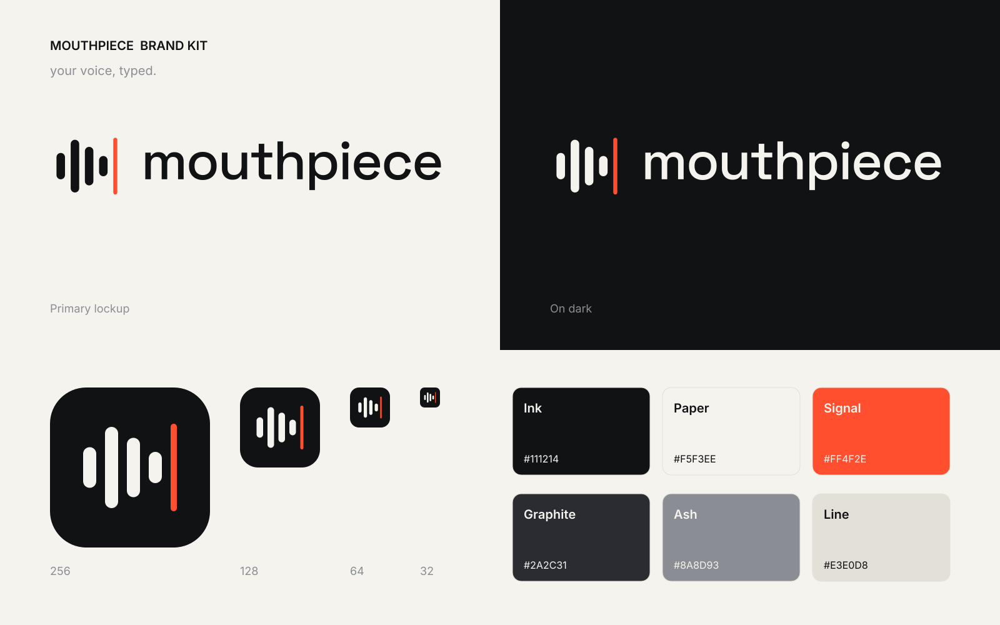

# Mouthpiece — marca

**Mouthpiece** é o app que fala o que você digita, com a sua voz. Slogan: **your voice, typed.**

## Ideia

O símbolo é uma **onda de voz que termina num cursor de texto**: quatro barras que diminuem até
virar o cursor, em vermelho. Voz entra, texto sai, e o contrário. É o app numa imagem.

A marca é **quieta**: quase toda em tinta e papel, com uma única cor de destaque. Ferramenta de
trabalho, não brinquedo.

## Arquivos

| Pasta | O quê |
|---|---|
| `logo/lockup.svg` / `lockup-light.svg` | Símbolo + nome. **Use este por padrão.** `-light` é para fundo escuro. |
| `logo/mark.svg` / `mark-light.svg` / `mark-mono.svg` | Só o símbolo. `mono` é para uma cor só (carimbo, gravação). |
| `logo/wordmark.svg` / `wordmark-light.svg` | Só o nome. |
| `icon/icon.svg`, `icon-*.png` | Ícone do app, de 16 a 1024 px. 16, 24 e 32 px são desenhados no grid de pixels. |
| `icon/mouthpiece.ico` | Ícone do Windows (16 a 256 px num arquivo só). |
| `icon/favicon.svg` | Ícone da aba do navegador. |
| `fonts/` | As fontes da marca, com as licenças (OFL, uso livre). |

O texto dos logos está convertido em contornos, então eles abrem iguais em qualquer lugar, sem
fonte instalada. Tudo é gerado por `brand/build.py`: para mudar cor ou forma, edite o script e rode
`python3 brand/build.py`, em vez de editar os arquivos gerados.

## Cores

| Nome | Hex | Uso |
|---|---|---|
| **Ink** | `#111214` | Texto, símbolo, fundo do ícone e do tema escuro |
| **Paper** | `#F5F3EE` | Fundo do tema claro, símbolo sobre escuro |
| **Signal** | `#FF4F2E` | **Só** o cursor do símbolo, a ação principal e o indicador de gravação |
| Graphite | `#2A2C31` | Superfícies no tema escuro |
| Ash | `#8A8D93` | Texto secundário |
| Line | `#E3E0D8` | Bordas e divisões no tema claro |

O Signal é a luz de "no ar" de um estúdio: aparece pouco, e por isso chama atenção. **Nunca** use o
Signal em textos longos, fundos grandes ou mais de um destaque por tela.

## Tipografia

| Fonte | Uso |
|---|---|
| **Space Grotesk** Medium | Nome da marca e títulos |
| **Inter** | Interface e textos |
| **JetBrains Mono** | Números, tempos, durações, código |

Nome sempre em minúsculas: **mouthpiece**. Em frases, "Mouthpiece" com maiúscula.

## Regras

- Respiro mínimo em volta do logo: a largura de uma barra do símbolo de cada lado.
- Lockup com pelo menos 120 px de largura; abaixo disso, use só o símbolo.
- Não mude as cores do símbolo, não gire, não distorça, não ponha sombra nem gradiente.
- Sobre foto ou cor forte, use a versão `-light` sobre uma faixa de Ink, nunca solta sobre a imagem.

## Tom de voz

Direto, curto e calmo. Fala como uma ferramenta de estúdio: diz o que está acontecendo ("gerando
2/5", "pronto"), sem exclamação, sem emoji, sem prometer demais.
